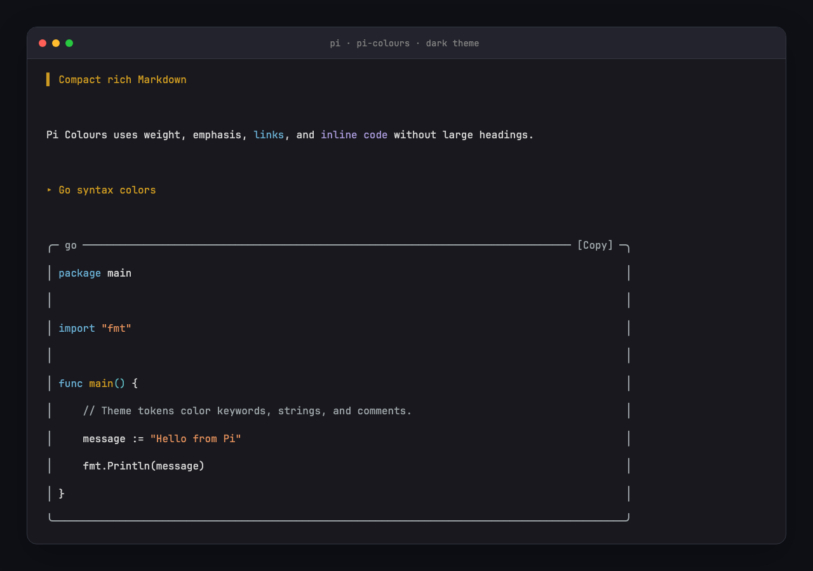
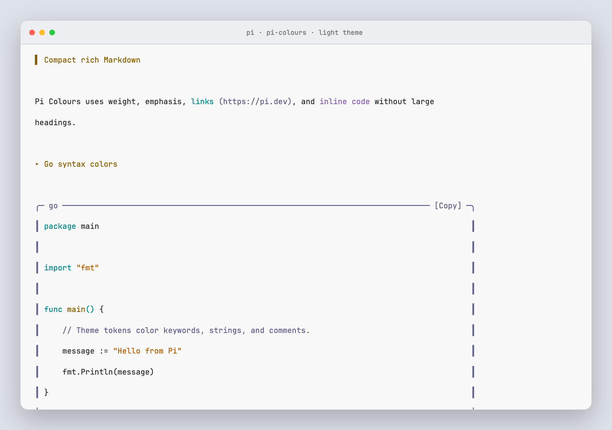

<div align="center">

# Pi Colours

**Compact Markdown, copyable code frames, and active-theme syntax colors for [Pi](https://pi.dev).**

[](https://www.npmjs.com/package/@wylu/pi-colours)
[](https://pi.dev/packages/@wylu/pi-colours)
[](https://github.com/wylu1037/pi-colours/actions/workflows/ci.yml)
[](LICENSE)

</div>

Pi Colours makes assistant messages, user Markdown, code blocks, and source-like Bash results easier to scan. It uses the active Pi theme. It does not force a dark or light palette.

Every code block renders in a rounded frame with a language label and a `[Copy]` chip, so you can copy a block with one click. A successful copy turns the chip into `[Copied]` for three seconds.

## Preview

### Dark Pi theme



### Light Pi theme



The screenshots use the real Pi Markdown component, the active theme, and the syntax highlighter. The preview includes compact Markdown, copy chips, and Go syntax colors for keywords, strings, and comments.

## Install

Install from npm:

```bash
pi install npm:@wylu/pi-colours
```

Or test the GitHub release without installation:

```bash
pi -e git:github.com/wylu1037/pi-colours@v0.1.0
```

Restart Pi after installation. Use `/reload` after you change a local copy.

## Copy code blocks

Every code frame shows a `[Copy]` chip in its top border:

```text
╭─ bash ────────────────────── [Copy] ─╮
│ openssl version -a                  │
╰─────────────────────────────────────╯
```

Copy a block in three ways:

| Action          | What it copies                                                           |
| --------------- | ------------------------------------------------------------------------ |
| Click `[Copy]`  | That block. Bash frames copy the full output, even when it is collapsed. |
| `/colours-copy` | The most recent code block in the conversation.                          |
| `ctrl+shift+c`  | The same as `/colours-copy`, in terminals that report the Shift key.     |

Pi confirms each copy with a short notification that includes the language and line count. The chip you clicked also switches to `[Copied]` for three seconds, so you can tell which block you copied.

Clicking needs fullscreen TUI mode, which is the default. In `regular` mode the frames still render; use the command or the shortcut to copy. The `ctrl+shift+c` shortcut needs a terminal with extended key reporting, such as Kitty, WezTerm, or Ghostty; in other terminals use `/colours-copy`.

## Try the built-in preview

Run this command in Pi:

```text
/colours-preview
```

The preview shows:

- compact Markdown headings;
- links, emphasis, lists, quotes, and inline code;
- labeled TypeScript and Go code with `[Copy]` chips;
- automatic Python language detection;
- dark or light colors from the active Pi theme.

Press Enter or Esc to close it. Clicking a `[Copy]` chip inside the preview copies that block too.

## What changes

| Output            | Pi Colours behavior                                                                            |
| ----------------- | ---------------------------------------------------------------------------------------------- |
| Markdown headings | Uses compact `▌`, `▸`, `•`, and `·` markers.                                                   |
| Fenced code       | Uses a rounded frame with a language label and a `[Copy]` chip instead of raw backticks.       |
| Labeled code      | Supports aliases such as `ts`, `tsx`, `py`, `sh`, `yml`, `c++`, and `c#`.                      |
| Unlabeled code    | Detects a language only when the code has a clear structure.                                   |
| Bash results      | Frames source-like output and adds syntax colors when the command or output gives a safe hint. |
| Copying           | Click `[Copy]`, press `ctrl+shift+c`, or run `/colours-copy`.                                  |
| Normal text       | Keeps prose and normal command output plain.                                                   |

Pi already gives syntax colors to `read` and `write` previews and semantic colors to diffs. Pi Colours keeps that behavior.

## Theme support

Pi Colours calls the syntax color functions from the active Pi theme. Select a theme with `/settings`.

For the best result, a custom theme must give different values to these Pi tokens:

- `syntaxComment`
- `syntaxKeyword`
- `syntaxFunction`
- `syntaxVariable`
- `syntaxString`
- `syntaxNumber`
- `syntaxType`
- `syntaxOperator`
- `syntaxPunctuation`

If these tokens use the same color, code will look monochrome.

## Highlighter choice

Pi uses `highlight.js` in its Markdown renderer. Pi Colours uses this engine because it:

- runs synchronously in the TUI;
- supports many languages;
- uses the active Pi theme;
- does not need grammar downloads or native modules.

Tree-sitter needs many grammar files and a separate token-to-theme layer. TextMate and Shiki add a large fixed-theme system. They do not give a clear benefit for this terminal extension.

## Coverage and limits

Pi Colours changes the shared Pi `Markdown` component. It applies to:

- assistant Markdown;
- user Markdown;
- Pi components and extension results that use `Markdown`.

It also replaces the built-in Bash display renderer. It does not change Bash execution.

The public Pi API has no global renderer hook for plain results from every third-party tool. A third-party tool that uses its own `Text` component keeps its own display. That tool can use Pi's exported `highlightCode()` function.

Pi Colours patches private methods in the Pi TUI `Markdown` class and adds a mouse handler to it, because Pi has no public hook for standard assistant and user renderers. The extension checks that these methods exist. If a later Pi version changes them, Pi Colours shows a warning and does not change message data.

## Security

Pi extensions run with full user permissions. Review extension code before installation.

Pi Colours does not use the network, read project files, write project files, or start a background process. Its Bash override delegates execution to Pi's original Bash tool. It writes to the system clipboard only when you trigger a copy.

## Development

Requirements:

- Pi 1.1 or later (click-to-copy needs the Pi 1.1 mouse support)
- Node.js 22.19 or later
- Chromium only when you regenerate screenshots

Run all checks:

```bash
npm install
npm run check
npm test
npm pack --dry-run
```

Regenerate the dark and light screenshots:

```bash
npm run screenshots
```

## License

[MIT](LICENSE)
